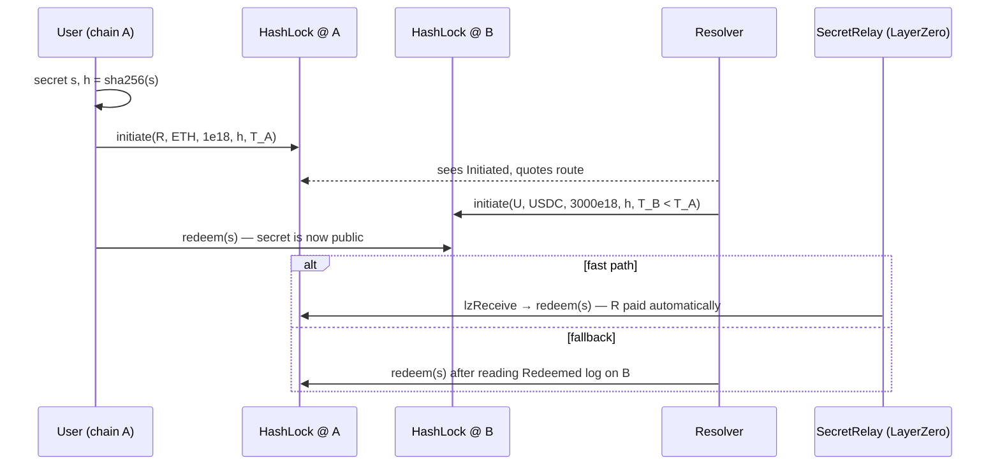

# Pactum

[](https://github.com/shaikyajash/pactum/actions/workflows/ci.yml)

**Trustless cross-chain atomic swaps between EVM chains.**

Pactum lets two parties swap assets across chains with no bridge, custodian or
wrapped token in the middle. Either both legs settle or neither does. It combines:

- **`HashLock`**: a hash time-locked contract (HTLC) supporting native ETH and
  ERC20, with an EIP-712 signed *instant refund* for unwinding abandoned swaps.
- **`SecretRelay`**: a LayerZero V2 OApp that carries the revealed secret back
  to the source chain and redeems the counter-leg automatically.
- **`resolver/`**: a TypeScript market-maker daemon and taker CLI (viem) that
  quote, fill, settle and refund swaps across chains.

## How a swap works



1. The user picks a random secret `s` and locks funds on chain A for the
   resolver, behind `h = sha256(s)`, until `T_A`.
2. The resolver mirrors the lock on chain B for the user, behind the **same
   `h`**, with a **shorter** timelock `T_B`.
3. The user redeems on B by revealing `s`. That publishes `s` on-chain.
4. Anyone can now redeem the resolver's leg on A, either over LayerZero
   (`SecretRelay`) or the resolver doing it directly.

### Why it's safe

| Risk | Mitigation |
|---|---|
| Resolver takes the user's funds without paying | Resolver never knows `s` until the user has been paid on B |
| User claims B, then refunds A | `T_B + safetyWindow ≤ T_A`, so the resolver always has time to redeem A first ([`timelock.ts`](resolver/src/timelock.ts)) |
| Counter-party disappears | Both sides refund after their timelock; or `instantRefund` with the redeemer's EIP-712 signature |
| Forged / replayed LayerZero message | LayerZero is used for **liveness only**. `redeem` still checks `sha256(s) == h` and always pays the fixed redeemer, so a bad message can't misdirect funds (fuzzed in `testFuzz_forgedMessagesCannotMisdirectFunds`) |
| Swap id collision across chains | Swap ids commit to `chainid` and contract address; EIP-712 domain is chain-bound |
| Non-standard ERC20s | `SafeTransfer` handles tokens that return no bool (USDT-style) |

**Not supported:** fee-on-transfer and rebasing tokens (the recorded amount
would not match the balance held).

## Layout

```
src/
  HashLock.sol               HTLC: initiate / redeem / refund / instantRefund
  lib/SafeTransfer.sol       minimal safe ERC20 + native transfers
  layerzero/SecretRelay.sol  LayerZero V2 OApp that relays secrets
script/
  Deploy.s.sol               CREATE2 deploy: same address on every chain
  DeployRelay.s.sol          deploy SecretRelay and wire peers
test/
  HashLock.t.sol             unit + fuzz
  InstantRefund.t.sol        EIP-712 signatures, malleability, replay
  AtomicSwap.t.sol           end-to-end across two simulated chains
  SecretRelay.t.sol          LayerZero delivery with a mock endpoint
  invariant/                 stateful fuzzing: conservation & finality
resolver/
  src/resolver.ts            fill → settle → refund engine
  src/client.ts              taker flow + fill acceptance rules
  src/bin/                   `resolver` daemon and `swap` CLI
  test/e2e.test.ts           full swap across two real anvil chains
```

## Getting started

Requires [Foundry](https://getfoundry.sh) and Node 22+.

```bash
git clone --recursive https://github.com/shaikyajash/pactum && cd pactum
forge test
cd resolver && npm ci && npm test   # includes the two-anvil e2e test
```

### Run a resolver

```bash
cp config.example.json resolver/config.json   # fill in contract addresses + routes
cd resolver
RESOLVER_KEY=0x... npm run resolver -- -c config.json
```

### Swap as a user

```bash
USER_KEY=0x... npm run swap -- -c config.json \
  --from sepolia --to base-sepolia \
  --resolver 0xRESOLVER --amount 0.1 --min-out 0.099
```

### Deploy

```bash
forge script script/Deploy.s.sol --rpc-url $RPC --broadcast --account deployer
LZ_ENDPOINT=0x6EDCE65403992e310A62460808c4b910D972f10f HASHLOCK=0x... OWNER=0x... \
  forge script script/DeployRelay.s.sol --rpc-url $RPC --broadcast --account deployer
```

## Roadmap

- [ ] Testnet deployments (Sepolia, Base Sepolia, Arbitrum Sepolia)
- [ ] Resolver: relay secrets through `SecretRelay` instead of polling the destination chain
- [ ] Persistent resolver state (currently in-memory)
- [ ] Permit2 support for gasless ERC20 approvals
- [ ] Bitcoin leg via P2WSH HTLC scripts
- [ ] Web UI

## License

MIT
