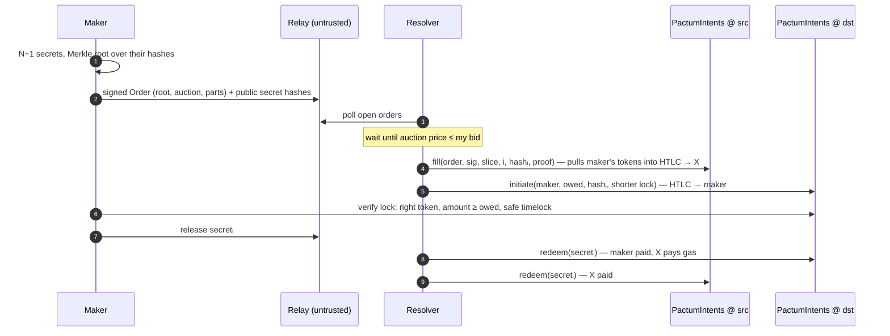

# Pactum

[](https://github.com/shaikyajash/pactum/actions/workflows/ci.yml)

**Gasless, partially fillable cross-chain swaps with no bridge and no custodian.**

A user signs one EIP-712 message saying *"sell 1000 USDC on Ethereum for at
least 0.25 ETH on Base"*. Resolvers compete in a Dutch auction to fill it,
possibly in several pieces, and the user receives ETH on Base without sending
a single transaction on either chain. Settlement is enforced by hash
time-locked contracts, so either both legs of every fill happen or neither does.

| | |
|---|---|
| **On-chain** (Solidity / Foundry) | `HashLock` HTLC · `PactumIntents` signed orders, Dutch auction, Merkle-committed partial fills · `SecretRelay` Chainlink CCIP auto-settlement |
| **Off-chain** (Rust / alloy / tokio / axum) | `pactum-core` protocol math · `pactum-relay` untrusted order relay · `pactum-node` maker agent, resolver, keeper and `pactum` CLI |

## How an intent settles



With a permit-capable token (USDC, DAI, …) the maker signs an EIP-2612 permit
alongside the order and **never sends a transaction on any chain**, not even an
approval.

## What makes it interesting

### 1. Gasless for the maker
`PactumIntents.fill` opens the source escrow from the maker's allowance using
their signature, and `redeem` is permissionless but always pays the escrow's
fixed redeemer. So the resolver can execute **every** transaction, including
the one that pays the maker, without being able to redirect a single wei.

### 2. Dutch-auction price discovery
The ask decays linearly from `startDstAmount` to `endDstAmount`. Each resolver
fills the moment the price crosses its own bid, so the maker gets the best
price the market will support without running an RFQ. The amount owed for a
fill is fixed on-chain at fill time (`OrderFilled.owedDstAmount`, rounded up
for the maker).

### 3. Partial fills without secret reuse
An order with `parts = N` commits to **N+1 secrets** in a Merkle tree. A fill
must use the secret whose index matches the cumulative fill level *after* it,
and indices only move forward:

```
parts = 4, srcAmount = 100
filled after:   1..25 → secret 0    26..50 → 1    51..75 → 2    76..99 → 3    100 → 4
```

Once a secret is revealed to settle one fill, it is public. Because no later
fill can lock behind it, nobody can use it to drain a later escrow. Leaves bind
`(index, hash)`, so a proof for secret 3 can never be passed off as secret 1.

### 4. Safety deposits keep the failure path gasless too
Every fill posts a native deposit (`order.minDeposit`), credited to a pull
ledger when the escrow settles:

| Settlement | Who is credited |
|---|---|
| `redeem` (swap completed) | the resolver gets its deposit back, whoever submits the secret |
| `instantRefund` (resolver consented) | the resolver |
| `refund` after expiry (fill abandoned) | **10%** to the keeper who called it, **90%** to the maker |

So if a resolver locks the maker's funds and walks away, a keeper running
`pactum keeper` is paid to refund the maker, and the maker is compensated
for the wait. A griefer who refunds itself still forfeits 90% of its deposit.
Credits are withdrawn with `withdrawDeposits`, so a party that rejects ETH can
never block settlement.

### 5. Chainlink CCIP for liveness, never for safety
`SecretRelay` carries revealed secrets to the other chain over CCIP and redeems
the other leg automatically. A forged or replayed message can't move funds
anywhere they couldn't already go, because `redeem` re-checks `sha256(secret)`
and pays a fixed address (fuzzed in `testFuzz_forgedMessagesCannotMisdirectFunds`).
Each entry gets a fixed gas budget, so one hostile redeemer can't starve the rest
of a batch, and an under-funded delivery reverts so CCIP can re-execute it.

## Security model

| Threat | Why it fails |
|---|---|
| Resolver takes the maker's tokens and doesn't pay | The maker releases secretᵢ only after verifying the destination lock pays ≥ owed |
| Resolver underpays | Owed amount is fixed on-chain at fill time; the maker's agent rejects short locks and the source escrow refunds |
| Maker claims dst, then refunds src | Destination lock expires `safetyWindow` before the source lock ([`timelock.rs`](crates/pactum-core/src/timelock.rs)) |
| A revealed secret is reused for a later fill | Secret indices are strictly increasing per order (`WrongSecretIndex`) |
| Resolver tampers with order terms | Any change alters the EIP-712 digest → `InvalidSignature` |
| Relay lies | It stores only verifiable data; signatures, roots and preimages are re-checked on-chain and by agents |
| Smart-contract wallet makers | EIP-1271 (and EIP-7702 delegated EOAs) for fills and instant refunds |
| A resolver abandons a fill | Keeper refunds after expiry; the resolver forfeits 90% of its deposit to the maker |
| MEV takes a resolver's deposit by redeeming first | Deposits are credited to the swap's redeemer, not the caller |
| Cross-chain replay | Swap ids and the EIP-712 domain commit to `chainid` and contract address |
| Non-standard ERC20s | `SafeTransfer` handles USDT-style tokens that return nothing |

**Not supported:** fee-on-transfer tokens (rejected on deposit with
`UnsupportedToken`) and rebasing tokens.

The contracts went through an internal security review; findings and fixes are
recorded in [SECURITY.md](SECURITY.md).

## Testing

```
forge test        115 Solidity tests: unit, fuzz, stateful invariants, audit regressions
cargo test        Rust unit + HTTP tests, plus three two-chain e2e scenarios on anvil
```

Highlights:
- **Invariants** (`test/invariant/`): balance conservation and settlement
  finality for `HashLock`; no overfill, escrow = fills, one-use secrets, and
  native balance = open deposits + credits under random concurrent fills.
- **Cross-language vectors**: the Rust Merkle tree, swap ids and EIP-712 type
  hash are checked against values produced by the Solidity code.
- **End-to-end** ([`e2e.rs`](crates/pactum-node/tests/e2e.rs)), on two live anvil
  chains with a real relay:
  - two resolvers split one permit-signed order at different auction prices, and
    the maker's transaction count is **0 on both chains**;
  - a rogue resolver abandons a fill, and a keeper refunds the maker for its tip
    while the maker is credited 90% of the forfeited deposit;
  - a resolver crashes mid-swap and a fresh process settles from its state file.

## Layout

```
src/
  HashLock.sol               HTLC: initiate / redeem / refund / instantRefund
  PactumIntents.sol          signed orders, Dutch auction, Merkle partial fills
  lib/MerkleSecrets.sol      index-bound secret commitments
  lib/SafeTransfer.sol       safe ERC20 + native transfers
  interfaces/IERC20Permit.sol
  ccip/SecretRelay.sol       Chainlink CCIP app for automatic settlement
  ccip/Client.sol            CCIP message types (layout-compatible with Chainlink)
crates/
  pactum-core/               orders, EIP-712, secret trees, auction, timelocks
  pactum-relay/              axum relay server + reqwest client
  pactum-node/               alloy chain adapter, Maker, IntentFiller, Keeper,
                             crash-safe state, and the `pactum` CLI
script/                      CREATE2 deploys for PactumIntents and SecretRelay
test/                        Foundry unit, fuzz, invariant and e2e tests
```

## Running it

Requires [Foundry](https://getfoundry.sh) and Rust 1.85+.

```bash
git clone --recursive https://github.com/shaikyajash/pactum && cd pactum
make test
```

Deploy (same address on every chain):

```bash
forge script script/Deploy.s.sol --rpc-url $RPC --broadcast --account deployer
```

Run a relay, a resolver and an intent (amounts in base units):

```bash
cargo run --release -- relay --listen 0.0.0.0:8080

RESOLVER_KEY=0x... cargo run --release -- resolve -c config.json \
  --rate-num 300000000000000000 --rate-den 1000000000 --max-fill-bps 6000 \
  --state resolver.json

MAKER_KEY=0x... cargo run --release -- intent -c config.json \
  --from sepolia --to base-sepolia \
  --sell-token 0xUSDC --sell-amount 1000000000 \
  --start 500000000000000000 --floor 250000000000000000 --parts 4 \
  --min-deposit 1000000000000000 --permit-version 2 --state maker.json

KEEPER_KEY=0x... cargo run --release -- keeper -c config.json
```

## Roadmap

- [x] Resolver safety deposits with keeper tips and maker compensation
- [x] EIP-2612 permits, so the maker never sends a transaction
- [x] Persistent maker and resolver state
- [x] Chainlink CCIP secret relay
- [ ] Testnet deployments (Sepolia, Base Sepolia, Arbitrum Sepolia)
- [ ] Permit2 for tokens without EIP-2612
- [ ] Route secrets through `SecretRelay` from the resolver daemon
- [ ] Bitcoin leg via P2WSH HTLC scripts

## License

MIT
